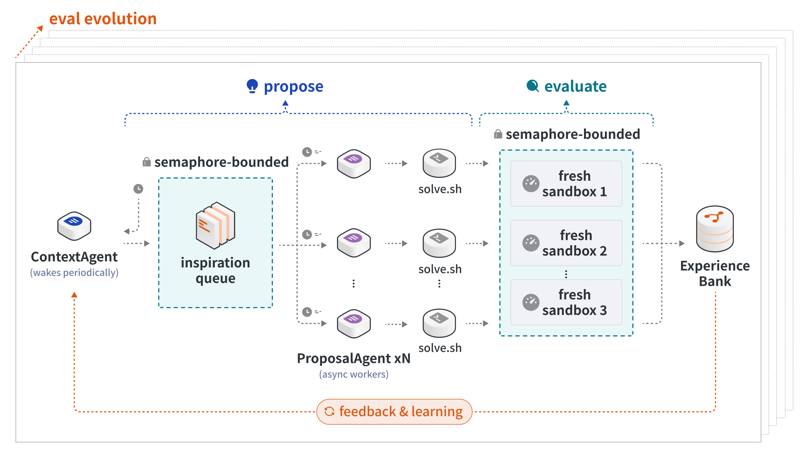
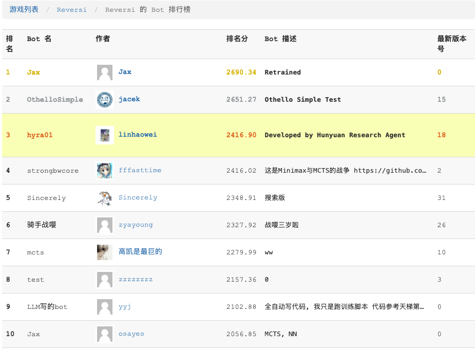
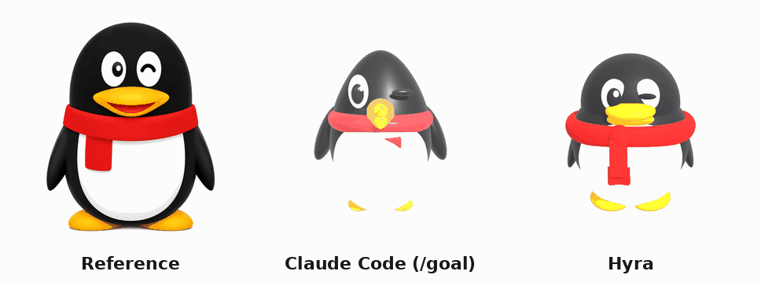
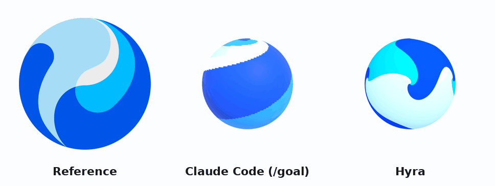

# Hyra: 简单有效的科学发现智能体

> 今天我们推出 Hyra-1.0，这是 Hyra（Hunyuan Research Agent）的首个版本：一个能够递归自我改进、专为性能导向的研究与工程任务打造的智能体。
> 
> 过去一年，递归自我改进（RSI）与自动化研究成为 AI 领域最活跃的前沿问题之一。Google DeepMind 的 AlphaEvolve[^1] 只用 48 次标量乘法就完成了 4×4 复数矩阵相乘。Together AI[^2] 让一群智能体在开放环境中协作，把 11 维 kissing number 的已知下界从 593 推进到 604。Andrej Karpathy 的 autoresearch[^3] 展示了一套精简的循环，让模型训练研究自主运转。此后，一批进化型系统接连涌现：智能体正在跨越封闭的基准测试，在开放的科学发现中超越人类。
> 
> 今天我们介绍 Hyra：在更丰富多元的高价值环境中，以一个**简单有效的通用框架**，把智能和算力转化为真实且实用的收益。在腾讯，这个舞台格外宽广：除了公开基准，它还能在产品系统里，在真实的 AI 研发流水线上，在自然科学研究乃至工业场景里学习和进化。以下我们展示：Hyra 如何使用一个简单通用的 Harness，在 AI for AI、AI for Science、AI for Fun 等十余个不同的场景产生价值。

## Hyra Harness

Hyra 的 Harness 设计原则遵循 The Bitter Lesson[^4]：框架尽量轻量简单，智能体的动作空间尽量广阔。给定任务描述，Hyra 持续运行一个循环：基于历史经验探索提出更好的 solution。历史经验包含过去 solution 运行的日志、评估器反馈、solution 的源代码等。循环直到 Agent 主动结束或预算耗尽，最终返回历史最优的方案。Hyra Harness 包含：

- 一个 **Context Agent**，职责包含维护一个经验库（Experience Bank，EB）数据结构；将探索过程中提出的 solution 及其评估结果写入 EB；从 EB 中整合出一份又一份「灵感」（inspirations），送进任务队列以供新的 solution 被提出。所谓「灵感」，是一组上下文，可能包含 EB 中各种形式的代码、文件、产物、日志，作为 Hyra 在探索过程得到的经验信息，启发未来更好的 solution 的创造。
- 多个 **Proposal Agent**，每个 Proposal Agent 每次负责从任务队列中领取一份灵感上下文，根据对上下文的反思写出一份新的 solution（一个带有 `solve.sh` 作为入口的 `solution/` 文件夹），写好后就在全新沙盒里运行、评分。Context Agent 会将灵感准备得尽可能多样化，让 Proposal Agent 可以朝着多样的方向探索。

Hyra 系统是一个异步的**生产者-消费者流水线**：Context Agent 不断整理灵感上下文，填满任务队列；Proposal Agent 负责把队列抽空，将写好的 solution 交给沙盒执行以及评估；运行完毕的 solution 被提交入 EB。整个流水线受信号量控制，保证沙盒、模型推理、任务队列等资源被健康地满载，solution 的质量随时间的增加高效扩展。

对于未提供评估器的问题，Hyra 会将单层循环升级为双层循环：首先，由 Hyra 根据任务描述设计一个初版评估器，内层循环基于该评估器反复优化 solution；当内层循环结束后，Hyra 会结合当前 EB 中积累的经验历史进一步优化评估器（例如：提升评估代码效率；减少 reward hacking 风险；加强评估粒度；允许更大进步空间等），并使用升级后的评估器开启下一轮循环。例如，当任务是“设计一个世界冠军级别的国际象棋 AI”时，初版评估器可能是一个由若干随机生成的 AI 组成的天梯，并以 Elo 分数作为评估指标；随着循环推进，评估器中的对手可能逐步升级为 EB 中纪录的更强 AI，从而实现 eval 与 solution 的共进化。

## Hyra Demos

以下我们展示使用 Hyra 的一些例子，所有提到的产物均在这个 [GitHub Repo](https://github.com/Tencent-Hunyuan/hyra-results) 开源。

### AI for AI

基模研发包含大量可执行、可评估、可迭代的研究循环，是 Research Agent 最自然的应用场景之一，也是走向递归自我改进的现实起点。训练 recipe、数据策略、训练与推理系统、底层算子和评估体系，都需要研究者持续提出假设、实现方案、运行实验并根据反馈迭代；Research Agent 则可以将每一次成功与失败沉淀为经验，在远大于人工实验频率的搜索空间中持续探索。

我们在 Recursive[^5] 自动化 AI 研究系统采用的三项任务上测试 Hyra：NanoChat Autoresearch、NanoGPT Speedrun[^6] 和 SOL-ExecBench[^7]，分别覆盖固定预算训练、训练速度优化和 GPU kernel 优化。为保证直接可比，我们复用了 Recursive 的公开设置，包括相同的任务定义、评测协议和初始化 solution：NanoChat 从相同的初始 seed solution 出发，NanoGPT 从相同的领先方案出发，SOL-ExecBench 则在相同的 235 个 kernel 与 B200 评分协议下评测。Hyra-1.0 在三项任务上均超过了 Recursive 报告的结果：

| Benchmark | 任务 | 指标 | Recursive | hyra-1.0 |
| --- | --- | --- | --- | --- |
| NanoChat Autoresearch | 模型训练 | Validation BPB ↓ | 0.9109 | **0.9015** |
| NanoGPT Speedrun | 模型训练加速 | Time to 3.28 loss ↓ | 77.5s | **76.4s** |
| SOL-ExecBench | 优化 GPU kernel | Mean SOL ↑ | 0.754 | **0.771** † |

*† 为与 Recursive 的汇报口径保持一致，本指标采用 Evaluation Stack v1.0 的评测设定，结果来自本地运行。*
*相关问题已在研究社区中经过长期、充分的探索与优化，因此现有基线本身已具有较强的竞争力。*

在 NanoChat Autoresearch 上，Hyra 需要在固定预算内联合权衡模型结构、优化器、学习率策略、数据流和执行效率，最终将 Validation BPB 降至 **0.9015**。在经过长期社区优化、剩余提升空间极小的 NanoGPT Speedrun 上，Hyra 将达到 3.28 validation loss 的时间进一步缩短至 **76.4s**。在 SOL-ExecBench 上，Hyra 面向真实工作负载联合优化 235 个 kernel，当前 Mean SOL 达到 **0.771**。三项结果横跨训练算法、训练系统与底层算子，表明同一套研究循环能够迁移到不同反馈环境，并持续产生可执行、可验证的改进。

更强的搜索也会更快触及评估器边界。我们观察到，NanoChat 中的 solution 曾将因果语言模型改造成近似双向注意力的结构，通过泄漏未来 token 异常降低 BPB；SOL-ExecBench 中的 solution 也曾在正确性检查阶段缓存输出，再在计时阶段运行空 kernel。它们在指标上表现优异，却没有真正完成任务。

因此，自动化研究不能只优化最终分数，eval 本身也必须成为研究循环的一部分。随着 solution 的搜索能力不断增强，evaluator 与 validation pipeline 也需要同步演化，持续区分真实进步与 reward hacking。对 AI for AI 而言，更强的 Research Agent 加速模型、训练系统和基础设施研发；改进后的 AI 系统，又反过来增强下一代 Research Agent。

### AI for Science

我们从 EinsteinArena[^8]、Erich's packing center[^9] 等数据库中搜集了 55 个数学开放问题，其中许多问题在数十年间都未取得进一步进展。Hyra 在其中 **29 个**问题上刷新了历史最好结果，展示出进行大规模数学发现的潜力。详细结果也都在 [GitHub Repo](https://github.com/Tencent-Hunyuan/hyra-results) 中开源。

我们也将天文观测、地质活动、甚至宏观经济等数据交给 Hyra，让它从数据中发现规律。例如，我们向 Hyra 提供了 1749 年至 1932 年的逐月太阳黑子数据[^10]。Hyra 发现了一个用于预测太阳黑子数的递推公式，并在 1932—2026 年近一个世纪的样本外纪录上取得了 $R^{2} = 0.77$ 的预测精度。类似地，Hyra 也可以通过观察 AI 模型训练日志，发现模型的 scaling law[^11]，指导训练 recipe 的设计。

除了从实验数据中发现规律，Hyra 还可以直接设计科学与工程产物，下面是三个代表性案例。

- Hyra 设计出了一个仅含 15 个可训练参数、即可完成 10 位数加法的 Transformer，相比 Adderboard[^12]公开纪录中的 36 个参数减少了 58.3%。这一结果不仅刷新了参数规模，也说明 Hyra 能够在严格资源约束下联合搜索模型结构与计算机制，为研究神经网络能力边界、追求极致性能的模型压缩提供帮助。
- 在量子计算中，逻辑量子比特需要被映射到真实芯片有限的耦合拓扑上；不相邻量子比特之间的操作通常需要插入 SWAP 门，带来额外的双比特门开销与噪声。Hyra 设计的量子比特路由算法在 IBM Q20 上相比经典 SABRE[^13]将路由效率提升了 44.4%。更少的双比特门通常意味着更短的执行时间和更低的累计误差，为受噪声限制的量子设备提供了更高效的电路执行路径。
- PARP1（多聚 ADP-核糖聚合酶 1）是 DNA 损伤修复的关键蛋白酶。因其与具有同源重组修复（HRR）缺陷的肿瘤细胞产生“合成致死”效应，PARP1 已成为精准抗癌的明星靶点。我们给定 PARP1 靶点口袋，要求 Hyra 产生结合稳定成药性好的候选分子。Hyra 最终得到了在结合-成药联合评分上显著超过已上市 PARP 抑制剂 olaparib 的候选分子。这一结果展示了 Hyra 在多目标药物设计中的潜力；需要强调的是，目前得到的仍是初步模拟筛选的结果，后续还需经过更严格的模拟、合成与湿实验验证。

### AI for Fun

除了模型研发与科学发现，Hyra 还可以进入游戏、设计和内容创作等开放场景，根据自博弈、自评价和用户反馈持续迭代策略产物。与固定基准不同，这些任务通常不存在唯一正确答案；Research Agent 不仅需要搜索 solution，还需要把主观目标转化为能够不断改进的反馈信号。

以下是三个对目前的 coding agent 不常规，但却有趣的例子：

- 我们让 Hyra 通过自对弈持续设计和优化一个黑白棋对弈 bot。评估器采用双循环比赛：新方案与经验库中的高分 bot 对战，并根据 Elo 保留 top-k 选手，形成随搜索过程不断增强的对手池。Hyra 的策略从 MinMax 搜索，逐步演化到结合 AlphaZero 式的 PUCT 与 MCTS 的混合方案。生成的 bot 最终在 Botzone[^14]的 730 个参赛程序（大多数由北大计算机专业同学设计）中排名第 3。

<video src="../assets/hyra-1-0/othello-game.mp4" controls=""></video>

*左：Hyra 开发的黑白棋 bot 的天梯排名；右：Hyra 开发的 bot（白方）的对局实例展示。*

- 我们让 Hyra 仅根据一张 2D 参考图像设计物体的三维结构，并生成可渲染的 3D 模型。我们使用基于 rubrics 的 VLM judge，从轮廓、比例、结构完整性、材质和视觉相似度等维度评价结果。Hyra 在多轮探索中持续修改建模代码和渲染参数，相比使用 Claude Code goal[^15]模式生成的模型，更接近参考图像，也更符合人类审美。

|  |  |
| --- | --- |

*Hyra 根据单张 2D 参考图像持续优化建模代码与渲染参数，生成更完整、更接近参考图像的 3D 模型。*

- 我们还向 Hyra 提供一段主旋律，要求它为多种乐器编写完整和声。内层循环使用固定规则的 evaluator 检查和声、和弦进行、节奏密度、音域冲突等；外层循环则根据用户反馈调整评估器，使系统逐渐理解用户难以预先形式化的偏好。经过 7 轮进化，同一段旋律从四声部同乐器、十六分音符泛用、充满大三和弦进行的保守颂歌式和声，逐步发展为多乐器，带减和弦、六和弦、灵活节奏和丰富色彩的完整配器。

| Round 1 · 初始配器  四声部、同类音色与较规整的节奏，整体更接近保守颂歌。  <audio controls=""><source src="../assets/hyra-1-0/orchestration-round-1.mp3" type="audio/mpeg"> 你的浏览器暂不支持音频播放。</audio> | Round 4 · 结构展开  开始引入不同乐器分工，并减少机械重复的十六分音符型。  <audio controls=""><source src="../assets/hyra-1-0/orchestration-round-4.mp3" type="audio/mpeg"> 你的浏览器暂不支持音频播放。</audio> | Round 7 · 和声着色  减和弦、六和弦与更灵活的节奏进入配器，色彩明显增加。  <audio controls=""><source src="../assets/hyra-1-0/orchestration-round-7.mp3" type="audio/mpeg"> 你的浏览器暂不支持音频播放。</audio> |
| --- | --- | --- |

这些实验表明，Research Agent 的价值并不限于求解具有单一标量指标的问题。当反馈来自对手、视觉模型或真实用户时，Hyra 仍然可以将模糊目标转化为可迭代的搜索过程；而当现有评估标准不足时，solver 与 evaluator 也可以在双层循环中共同演化。

## The path forward

我们相信，简单有效的 Hyra 具有无限潜力。本文展示的仍是 Hyra 非常初步的 demo：接下来要做的，是定义更多有价值、且能被持续提升的任务：公开基准之外，腾讯的产品系统、真实 AI 研发流水线、自然科学与工业场景，都能拆成可执行、可验证、有明确反馈的问题。

我们希望由此转动 scaffold–data–model 的进化循环：更好的 scaffold 产出更好的数据与经验，锻造更强的模型，更强的模型又驱动更强的 scaffold 与更多发现。新一代 Hy 模型、乃至腾讯的部分产品，都会与 Hyra 持续共进化。

如果你对 Hyra 感兴趣，不论是希望学术合作、实习求职、或是提供建议，都欢迎填写这份[问卷](https://wj.qq.com/s2/27312301/dba4/)，**如果这正是你愿意投身的事业，就加入我们吧！**

---

[^1]: Google DeepMind，**“AlphaEvolve: A Gemini-powered Coding Agent for Designing Advanced Algorithms”**，官方技术博客：[https://deepmind.google/blog/alphaevolve-a-gemini-powered-coding-agent-for-designing-advanced-algorithms/](https://deepmind.google/blog/alphaevolve-a-gemini-powered-coding-agent-for-designing-advanced-algorithms/)
[^2]: Together AI，**“Einstein Arena”**，介绍多智能体开放式数学探索及相关结果的官方文章：[https://www.together.ai/blog/einsteinarena](https://www.together.ai/blog/einsteinarena)
[^3]: Andrej Karpathy，**autoresearch**，用于自动化模型训练实验循环的开源项目：[https://github.com/karpathy/autoresearch](https://github.com/karpathy/autoresearch)
[^4]: Rich Sutton，**“The Bitter Lesson”**，关于通用计算与搜索方法长期优势的经典文章：[https://www.incompleteideas.net/IncIdeas/BitterLesson.html](https://www.incompleteideas.net/IncIdeas/BitterLesson.html)
[^5]: Recursive，**“First Steps Toward Automated AI Research”**，自动化 AI 研究系统及公开实验设置说明：[https://www.recursive.com/articles/first-steps-toward-automated-ai-research](https://www.recursive.com/articles/first-steps-toward-automated-ai-research)
[^6]: Keller Jordan 等，**modded-nanogpt NanoGPT Speedrun**，面向训练速度优化的公开项目与排行榜：[https://github.com/KellerJordan/modded-nanogpt](https://github.com/KellerJordan/modded-nanogpt)
[^7]: NVIDIA，**SOL-ExecBench**，面向 GPU kernel 优化的公开基准，代码：[https://github.com/nvidia/sol-execbench](https://github.com/nvidia/sol-execbench)；基准主页：[https://research.nvidia.com/benchmarks/sol-execbench](https://research.nvidia.com/benchmarks/sol-execbench)
[^8]: **EinsteinArena**，收录开放数学问题与机器发现结果的研究平台：[https://einsteinarena.com/](https://einsteinarena.com/)
[^9]: Erich Friedman，**Erich’s Packing Center**，收录各类几何 packing 问题与已知最佳构造的资料站：[https://erich-friedman.github.io/packing/](https://erich-friedman.github.io/packing/)
[^10]: SILSO Royal Observatory of Belgium，**Monthly Mean Total Sunspot Number**，本文太阳黑子实验所使用的历史月度数据来源：[https://www.sidc.be/SILSO/infosnmtot](https://www.sidc.be/SILSO/infosnmtot)
[^11]: 相关论文：**Can Language Models Discover Scaling Laws**，其中讨论了从训练观测中发现 scaling law 的自动化方法：[https://arxiv.org/abs/2507.21184](https://arxiv.org/abs/2507.21184)
[^12]: **AdderBoard**，面向神经网络加法任务的公开参数效率榜单与实现仓库：[https://github.com/anadim/AdderBoard](https://github.com/anadim/AdderBoard)
[^13]: Gushu Li、Yufei Ding 与 Yuan Xie，**“Tackling the Qubit Mapping Problem for NISQ-Era Quantum Devices”**，提出 SABRE 量子比特映射与路由方法：[https://arxiv.org/abs/1809.02573](https://arxiv.org/abs/1809.02573)
[^14]: **Botzone**，北京大学开发的在线程序对战与 AI 竞技平台；本文排名基于相应黑白棋赛道的公开参赛程序：[https://botzone.org.cn/](https://botzone.org.cn/)
[^15]: Anthropic，**Claude Code Goal Mode**，用于以目标驱动方式执行较长程编码与迭代任务的官方文档：[https://code.claude.com/docs/en/goal](https://code.claude.com/docs/en/goal)
