<!-- _class: lead -->
<!-- _paginate: false -->

# GANDALF：把 GRU 的门控搬来选特征

一个可以把 MLP 换掉的表格单元，以及它自带的特征重要性

论文：*GANDALF: Gated Adaptive Network for Deep Automated Learning of Features for Tabular Data*（arXiv:2207.08548v6）

---

## 它想解决的问题：网络该不该「少看几列」

一个纯 MLP 喂进 d 列，就把所有列和它们的交互一律看待。表格里常有大量噪声列，全看等于给自己加噪。

已有的两种做法各有代价：

- **TabNet**：用注意力选特征，但选择发生在**单个样本**上，是 instance level 的；
- **DANet**：用 α-entmax 掩码做稀疏，但需要 BatchNorm 兜住训练。

GANDALF 的定位是第三条：**不要注意力、不要 BatchNorm，用可学的稀疏掩码做全局选列。**

> 选特征的粒度是「列」，不是「这份样本里的这列」。

---

## 核心动作：把 GRU 的「时间步」换成「阶段」

GRU 本来就是干这件事的：每一步决定保留多少旧记忆、写入多少新内容。它靠两个门说话——重置门 $r$ 和更新门 $z$。

问题是表格没有时序。「表格没有任何内在的时序结构，行与列都没有预定义顺序。」

所以论文做了一个替换：**递推轴从时间步改成阶段**。同一份特征矩阵 $X$ 被喂进 $N$ 个串联的 GFLU，每个阶段换一个掩码、换一套权重。

- 记忆从「隐藏状态」变成「学出来的特征表示」；
- 每阶段的输入不是新的一段序列，而是**同一张表的另一个视角**。

> 结构照抄 GRU，语义整个换掉：这是这套方法最省力也最关键的一步。

---

## 三个和 GRU 不一样的地方

| | GRU | GFLU |
| --- | --- | --- |
| 递推轴 | 时间步 $t$ | 阶段 $n$ |
| 权重 | 跨时间步共享 | **逐阶段不同** |
| 输入 | 每步新的一段序列 | 同一份 $X$，每阶段换掩码 |

对第二点的理由很直白：每个阶段都做同样的变换未必最优，甚至可能拖累表现。阶段的本职是「一轮一轮地把特征子集筛出来」，那就该让每轮有自己的参数。

第三点才是 GANDALF 真正的新东西：**每阶段的输入是 $X$ 乘上一个稀疏掩码**，于是「看哪些列」本身成了可学参数。

---

## 先把整条线看一遍

数据只往一个方向流：原始 $X$ 进第一段 GFLU，每段换一张掩码、换一套权重，走完 $N$ 段得到表示 $H$，再过一个小 MLP 头输出。虚线是副产品：各段掩码相加就是特征重要性。

---

## 一个阶段里发生了什么

三份输入：打分向量 $F_n$ 造掩码，上一段表示 $H_{n-1}$ 带记忆，**全特征 $X$ 同时进候选**。两个门看的是掩码后的 $X_n$，候选看的是完整的 $X$：这是全篇最容易被忽略的一条边。两个门的输出与候选按 $z_n$ 插值成 $H_n$，式子见下页。

---

## GFLU 的前向：掩码 → 两个门 → 插值更新

第 $n$ 个阶段（掩码 $M_n\in\mathbb R^d$，输入 $X_n=M_n\odot X$）：

$$
z_n=\sigma\big(W_n^z\cdot[H_{n-1};X_n]\big),\qquad
r_n=\sigma\big(W_n^r\cdot[H_{n-1};X_n]\big)
$$

$$
\tilde H_n=\tanh\big(W_n^o\cdot[r_n\odot H_{n-1};\;X]\big)
$$

$$
H_n=(1-z_n)\odot H_{n-1}+z_n\odot\tilde H_n
$$

三个容易读漏的点：两个门吃的是**掩码后**的 $X_n$，候选吃的却是**全特征** $X$；更新是插值不是覆盖，$z_n\to0$ 就几乎不改表示；两个门可以合并成一个 $2d\times 2d$ 矩阵一次算完。

---

## 设计取舍：为什么掩码只进两个门

如果掩码也作用到候选支路，被置零的列在候选里同样拿不到梯度。作者的理由写得很直接：避免掩码造成的稀疏**阻断梯度流**。

后果有两个，一好一坏：

- 好：稀疏不会让训练卡住，掩码可以开得很狠（初始化稀疏度能到 0.9）；
- 坏：**掩码为 0 的列仍然会通过候选支路影响输出**，所以掩码不能读成「这个特征没被使用」。

作者称这组设计「经验上更优」，但论文没有给出这组对照的数字。

> 这条是本篇最值得记住的边界：解释性和梯度，在这里是同一个决定的两面。

---

## 稀疏掩码怎么来：t-softmax

普通 softmax 每一项恒正，做不了硬选择。t-softmax 先给每项一个权重再归一化：

$$
\text{softmax}(a_i,w_i)=\frac{w_i e^{a_i}}{\sum_j w_j e^{a_j}},
\qquad w_i=\mathrm{ReLU}\big(a_i+t-\max(a)\big),\ t>0
$$

$a_i$ 是第 $i$ 列的可学打分 $F_{n,i}$，$t$ 是阈值。由此得到三条可操作的读数：

1. **稀疏是精确置零**：$a_i\le\max(a)-t$ 的项权重恰为 0，分子分母同时消失；
2. **至少有 1 项非零**：最大那项拿到 $w=t>0$，所以掩码不会整行为空；
3. **代价接近普通 softmax**：不需要 α-entmax、sparsemax 那种排序操作。

---

## Init Sparsity 到底在调什么

论文用 r-softmax 只干一件事：给 $t$ 定初值。

$$
\text{r-softmax}(x,r)=\text{t-softmax}(x,t_r),\qquad
t=-\text{quantile}(x,r)+\max(x)
$$

代回上一页的置零条件：被保留的项满足 $a_i>\max(a)-t=\text{quantile}(a,r)$，也就是**约 $r$ 比例的打分被置零**。

于是超参 `Init Sparsity ~ U(0, 0.9)` 的语义就是「开局先关掉多少列」。（这一步等价关系是本库的推导，原文只写「用它初始化 $t$」。）

$t$ 本身也可以设成可学参数，此时初始化「不是必需，但有帮助」——它决定的是训练起点有多稀疏。

---

## 阶段之间怎么不一样：用 Beta 分布初始化掩码

打分向量不是随机初始化的，而是从 Beta 分布采样：

$$
F_n\sim\text{Beta}(\alpha_n,\beta_n),\qquad \alpha_n,\beta_n\sim U(0.5,10)
$$

作者明确说这是「偏离高斯分布」的选择，图的是两件事：

- **多样性**：每个阶段抽到不同的 $(\alpha_n,\beta_n)$，于是每个阶段天然用不同的列视角；
- **稀疏**：Beta 采样偏小值，开局就打散权重。

这顺便省掉了一个正则项：阶段塌缩（多个阶段选同一批列）在初始化层面就被打散了。

---

## 组装：$N$ 个阶段 + 一个小 MLP 头

完整前向很朴素：输入 $X\in\mathbb R^d$ 过 $N$ 个 GFLU 得到表示 $H\in\mathbb R^{\tilde d}$，再过一个 $K$ 层 MLP 输出。回归时加上训练集均值 $T_0$。

实验里的两个细节：

- MLP 头固定为两层 32/16、ReLU——**容量都在 GFLU 里，头很薄**；
- $\tilde d$ 取成和 $d$ 相同，表示不降维。

也就是说，这个模型的可调容量几乎全压在「阶段数」这一个旋钮上。

---

## 参数账本：线性长在阶段数上

按式子的维度手算（取 $\tilde d=d$）：每阶段两个门合并成 $W_n^i\in\mathbb R^{2d\times 2d}$ 有 $4d^2$，候选 $W_n^o$ 有 $2d^2$，掩码 $F_n$ 有 $d$。

$$
\Rightarrow\; 6d^2+d \ \text{每阶段，随 } N \text{ 线性增长}
$$

这条账本解释了两件事：

- 相对 FT-Transformer / ResNet，论文报的 MACs 与参数量都在更低一档；
- 但调参出来的最优阶段数在 2 到 30 之间都有，参数量的浮动范围取决于你选几阶段。

（本页为按原文维度的推算，论文未给该式。）

---

## 解释性：把各阶段的掩码加起来

$$
I=\sum_{n=1}^{N}M_n,\qquad I^{norm}_i=\frac{I_i}{\sum_i I_i}
$$

掩码是**逐列、逐阶段**的全局量，不随样本变化，所以直接求和就能读成一列特征在整条网络里的平均权重——性质上类比 GBDT 的特征重要性。

每个 $M_n$ 在被保留的项上加和为 1，因此 $I$ 的总质量恰为 $N$，$I^{norm}$ 读作「第 $i$ 列占全部阶段权重的份额」。

**边界**：它反映的是门控支路有多依赖这列；候选支路始终看全特征，所以别把它当因果归因用。

---

## 代价：阶段之间不能并行

这是作者自己写下的限制：阶段之间是顺序依赖，「内在的顺序处理排除了并行」。

这是一个结构性代价，不是实现没写好：

- 每阶段的输入依赖上一阶段的 $H$，$N$ 就是链长；
- 特征数 $d$ 越大，单个阶段的矩阵越宽，链也越长；
- 论文只报了参数量和 MACs，没有给训练/推理的 wall-clock。

> 参数少不等于跑得快。这条要和「成本低」的说法一起读。

---

## 证据一：在别人选的子集上拿了第一名

Tabular Benchmark（Grinsztajn 等 2022）的 45 个数据集里，作者挑了 18 个，按 ADTM 聚合平均分：

GANDALF 0.829、XGBoost 0.577、GBDT 0.476、HistGBDT 0.462、RandomForest 0.433、SAINT 0.384、FT-Transformer 0.370、ResNet 0.218、MLP 0.147。

子集的筛选规则是四条：只用中等规模、不做 target/data 变换、特征数 > 20、数值与类别版本都在时取类别版。

逐数据集数：**13/18 最优**。输掉的五个是 topo_2_1、MiniBooNE、heloc、cpu_act、yprop_4_1，其中三个输给 XGBoost。

---

## 证据二：换一套基准，第一名没了

TabSurvey（Borisov 等 2022）上，同样的 ADTM 口径给出的是另一个排序：

XGBoost 0.957、CatBoost 0.947、**GANDALF 0.945**、LightGBM 0.925、SAINT 0.915……

四个数据集里两胜两负：Covertype（97.7，最高）与 Cal. Housing 的 MSE（0.16，最低）赢，Adult（86.7 对 LightGBM 87.4）与 HIGGS（76.9 对 SAINT 79.8）输。

> 所以更准确的说法是：GANDALF 在最强的 GBDT 之列，但没有稳定超过它们。不是「DL 赢了 GBDT」。

---

## 这套证据的边界比数字更需要记住

两边都是**不重跑基线**：作者只训练 GANDALF，其余模型的分数直接取两个基准已发布的数字，只是把 GANDALF 塞进同一套划分、预处理与指标。

由此产生的四条限制：

- 调参预算不对等：GANDALF 一侧是 100 次 Optuna 试验，各基线在基准里的预算未必相同；
- **没有显著性检验**；表里多数数据集只有 1 折，单点分数差没有可比较的不确定度；
- 18 个是筛出来的子集，不能外推到大规模、强变换、高基数类别的数据；
- 没有「默认 GANDALF」：只给了搜索空间和逐数据集最优配置，开箱即用无从谈起。

> 这篇的基准部分应当读成「作者在自己的协议下跑了一次」，而不是第三方复现。

---

## 调参：五个维度，阶段数最要紧且最没规律

搜索器是 Optuna 的 TPE，100 trials，前 10 个纯随机。五个维度：

- 阶段数：2–30
- GFLU dropout：0–0.5
- init sparsity：0–0.9
- weight decay 与 learning rate

FANOVA 的重要度排序很清楚：**阶段数最高**（中位数约 0.45），init sparsity 与 dropout 次之（约 0.28–0.30）。

麻烦在于作者对这一个是这么说的：阶段数影响最大，但「看不出任何特定规律」——直方图在 2–6 与 18–21 各聚了一簇。

收敛倒是很快：第 4 到第 5 个 trial 就到了 13–14 个数据集最优的平台，之后基本平着。

---

## 解释性实验读的是什么

ground truth 用的是两个事后归因方法的 top 25 特征（GradientSHAP 与 DeepLIFT），再算 NDCG@K。GANDALF 在 $K\in\{1,5,10,15,25,50\}$ 上都不低于 XGBoost。

保真度用 MoRF / LeRF 测：按最相关顺序把特征换成高斯噪声时掉得快，按最不相关顺序换时掉得慢。

但这套实验有两个要留意的地方：

- ground truth 本身是另一个归因方法的输出，**不是真实重要性**；被比较的 XGBoost 也没交代调参状态；
- 多个数据集的特征数不到 25（最少 21），原文没说这些数据集是否被排除。

> 结论只能读成「和 XGBoost 至少打平」，不能读成「它的重要性更接近真相」。

---

## 什么情况下值得把它排进候选

作者自述优势可能更明显的情形是：**特征数多**、**特征与目标的关系不直接**。实验也只在特征数 > 20 的子集上做。

四个问题都答「是」再考虑：

- 列多，且你知道里面有相当一部分是噪声？
- 你愿意为阶段数做一次真实搜索（它在 2 到 30 之间都可能赢）？
- 你对可解释性的要求是「看整体依赖哪几列」，不是「删掉这列会掉多少分」？
- 你能接受它无法并行、也没有现成默认配置？

否则它就该留在「值得跑一次对照」的位置，而不是新的默认基线。

---

## 想继续往下读

按顺序读最顺的三个页面：

- `wiki/sources/gandalf.md` — 论文摘要、两套基准读数、10 条内部矛盾与待解问题
- `wiki/concepts/gated-feature-learning-unit.md` — GFLU 与 t-softmax 的机制页
- `wiki/comparisons/gbdt-vs-tabular-dl.md` — 与 GBDT 的对照，以及这份协议该怎么读

选型上的位置见 `wiki/practices/tabular-model-selection.md`，同期的另一份同协议读数见 `wiki/sources/ft-transformer.md`。

一句话带走：**这套方法的可复用部分不是 0.829 这个分数，而是「门控 + 逐阶段稀疏掩码」这三处设计，以及每一处各自付了什么代价。**
