

<!-- _class: lead -->
<!-- _paginate: false -->

# 生成式表格建模

## 从 FT-Transformer 到 Q-FT、TFMs 与 LLMs

一条主线：**表格如何变成序列，标签又应该放在序列的哪里？**

机制、公式、工程配方、证据边界

---

## 先看结论：这不是一条单纯的“模型变大”路线

FT-Transformer、Q-FT、文本化 GPT 都用了 Transformer，但它们解决的不是同一个问题。

- **FT-Transformer**：把每列变成 token，让注意力学习列间交互；
- **Q-FT**：保留逐列 token，把小型 Transformer 换成语言模型骨干；
- **Q-FT v2**：把“列顺序无意义”从增强技巧变成结构约束，再加入表格自监督；
- **文本化 GPT**：不再设计 feature tokenizer，把整行写成句子；
- **target-first GPT**：不只是预测标签，而是给每种标签下的整行打分，再用 Bayes 公式分类；
- **TFM**：把训练行本身放进上下文，把“学习这张表”移到推理阶段。

> 真正的演进轴是：结构从哪里来，建模对象是什么，顺序与推理成本由谁承担。

---

## 先澄清：“生成式表格模型”有两种常见含义

**第一种：生成式分类。** 学习 $p(x\mid y)$ 与 $p(y)$，再计算 $p(y\mid x)$。输出仍然是标签，不生成新数据。

**第二种：表格数据生成。** 学习整行的分布 $p(x)$ 或 $p(x\mid y)$，逐 token 采样合成新行。GReaT 属于这一路。

两者共享“对行建模”的技术，但任务不同：

- 本 deck 的主线是**第一种**：生成式分类如何从前面的表格 Transformer 自然长出来；
- 第二种会作为数据生成假设出现，用来解释 target-first 为什么在特定赛题上占优。

> FT-Transformer、Q-FT、Q-FT v2 都是判别式监督模型。用了 LLM，不等于成了生成式分类器。

---

## 四条“foundation 风格”路线，先放在同一张地图上

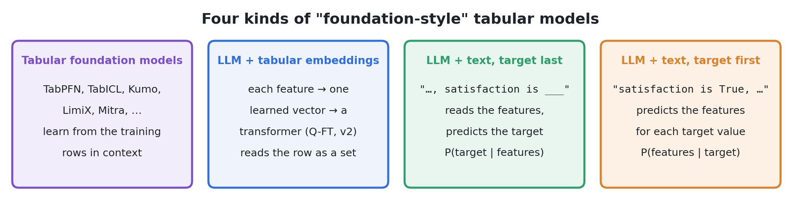

从左到右，变化的是信息入口：训练行、逐列向量、特征在前的文本、标签在前的文本。

“foundation 风格”是来源的分类措辞，不代表四者都有相同的预训练规模或零样本能力。

---

# 第一幕：FT-Transformer

先把“每列一个 token”讲清楚

---

## 表格深度学习的起点：列不是词，行也不是句子

图片有空间局部性，文本有词序；表格只有一堆异质列。

直接把 $k$ 列拼成一个向量，MLP 可以学交互，但每一列的身份、类型与尺度都压在同一个输入层里。

FT-Transformer 的选择是：

1. 每列先变成独立的 $d$ 维向量；
2. 保留列身份，不假设各列同质；
3. 用注意力显式学习列间关系；
4. 用一个汇总 token 读出预测。

> “token”在这里不是文本分词器切出来的词片，而是一列的可学习表示。

---

## Feature Tokenizer：数值与类别走不同通道

对第 $j$ 列：

$$T_j=b_j+f_j(x_j)\in\mathbb{R}^d$$

数值列：

$$T_j^{(num)}=b_j^{(num)}+x_j^{(num)}W_j^{(num)}$$

类别列：

$$T_j^{(cat)}=b_j^{(cat)}+e_j^\top W_j^{(cat)}$$

- $W_j^{(num)}$ 是这一列专属的 $d$ 维方向；
- $W_j^{(cat)}$ 是这一列专属的 $S_j\times d$ 查找表；
- $b_j$ 是这一列专属的偏置，让模型即使面对相同数值，也知道它来自哪一列。

---

## 一个容易被忽略的重点：没有位置编码

$k$ 个特征 token 加上 `[CLS]`，进入双向 Transformer，最后读 `[CLS]`：

$$T_0=\operatorname{stack}[[CLS],T_1,\ldots,T_k]$$

$$\hat y=\operatorname{Linear}\big(\operatorname{ReLU}(\operatorname{LayerNorm}(T_L[CLS]))\big)$$

模型不注入列位置。交换特征 token，同时交换对应的列参数，`[CLS]` 的输出不变。

这让“表是集合”成为结构性质，而不是靠数据增强近似学出来的习惯。

消融也给列身份提供了支持：去掉逐列偏置后，8 个数据集中的 7 个变差。

> 综合：FT-Transformer 的关键不是“用了注意力”，而是“逐列身份 + 无位置的集合注意力”。

---

## 主干很朴素，优化细节却不随意

默认 FT-Transformer：3 层、192 维、8 个头，按 100 个数值特征计约 929K 参数。

- PreNorm：归一化位于残差分支入口；
- 第一层的第一个 normalization 被去掉，官方实现标为关键细节；
- 预测头是 `LayerNorm → ReLU → Linear`；
- 默认 AdamW，学习率 $10^{-4}$，权重衰减 $10^{-5}$；
- 数值列默认做分位数变换，回归目标标准化。

最后一层还有一项实现优化：只计算 `[CLS]` 的 query，key/value 仍来自全部 token。

> 这些细节说明：表格模型不是把通用 Transformer 原样搬来就能稳定工作。

---

## 成本与能力都来自“列间全连接”

$k$ 个 token 的标准自注意力成本约为：

$$O(k^2d)$$

收益：任意两列都能直接交互，不必把交互埋在一个长向量的深层 MLP 里。

代价：列数上千时，注意力矩阵本身成为瓶颈。原论文在 2000 列的 Epsilon 上使用 Linformer 式 KV 压缩，把约 2001 个 token 压到约 128 维。

实测训练时间不是单纯由 $k$ 决定：FT-T 相对 ResNet 从 0.9× 到 13.8×，还受调参后的层数、宽度与早停影响。

> 架构复杂度给的是缩放趋势，不是一张可直接套用的耗时表。

---

## FT-Transformer 的证据应该读成什么

同一协议下，11 个数据集、9 个深度模型与 2 个 GBDT 对照：

- 调参后的单模型平均排名：FT-T 1.8，ResNet 3.3，MLP 4.8；
- 默认集成在 9/11 个数据集上同时优于默认 XGBoost 与 CatBoost；
- 调参后，GBDT 在若干数据集反超，没有普适赢家；
- 平均排名最好不等于逐数据集最好：FT-T 只有 5/11 个列均值最佳。

证据边界同样重要：11 个数据集中 10 个纯数值，没有缺失值实验，每个数据集只有一个固定划分，也没有预训练或外部数据。

> FT-T 是一个强监督基线，不是表格生成模型，更不是“LLM 已解决表格问题”的证据。

---

## 从 FT-T 到 LLM：真正要决定的是三个接口

把小型 Transformer 换成语言模型，表面上是换 backbone，实际上要重新回答三个问题：

1. **输入接口**：文本 token id，还是直接给连续向量？
2. **顺序接口**：保留语言模型的位置与因果掩码，还是恢复“行是集合”？
3. **参数接口**：全量微调，冻结骨干，还是低秩适配？

Q-FT 的答案依次是：`inputs_embeds`、随机重排 + 末尾 CLS、LoRA。

Q-FT v2 又把第二个答案改成：双向编码器 + 全部位置编号为 0。

---

# 第二幕：Q-FT

把逐列嵌入直接送进语言模型

---

## Q-FT 全貌：21 列变成 22 个位置

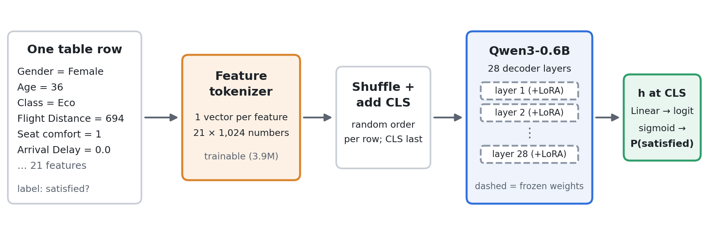

21 个特征各变成一个 1024 维向量，重排后在末尾加 CLS，送入 Qwen3-0.6B。最终只读 CLS 的隐藏状态做二分类。

标签从不进入输入；训练目标仍是普通的二元交叉熵。

---

## 三段式嵌入：列是谁、值是什么、数值多大

$$t_j=\operatorname{RMSNorm}\left(e_j^{col}+e_j^{val}(x_j)+f_j^{num}(x_j)\right)\cdot g$$

- **列嵌入**：用列名的 Qwen 词向量均值初始化，之后继续训练；
- **值嵌入**：按这一列的离散 code 查表；
- **数值嵌入**：只对 4 个数值列启用，标准化后进入周期特征与 MLP；
- **尺度对齐**：RMSNorm 后再乘 gain，使 token 的 RMS 约为 0.030，接近 Qwen 常见词向量尺度。

> 这三路不是三种可选方案，而是相加进同一个 token 的并行信息通道。

---

## 一个单元格如何变成 token：Flight Distance = 694

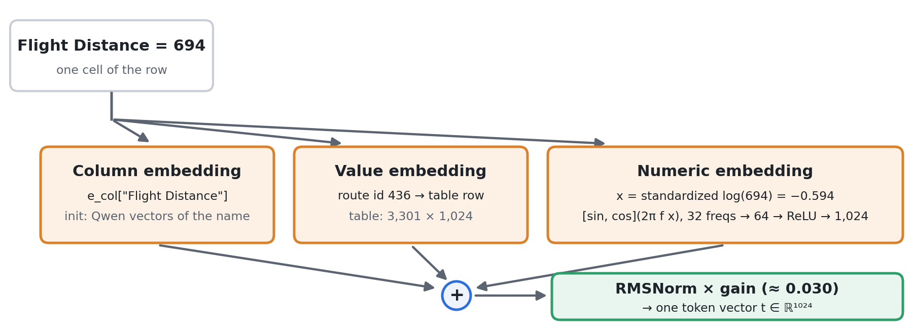

同一个距离被双重编码：route id 436 提供“这条航线”的身份，标准化 log 距离 $-0.594$ 提供连续数值。

---

## 为什么 Flight Distance 要同时当 ID 和数值

只当数值：模型可以在相邻距离间共享信息，却难以表达“某条具体航线”的固定乘客构成。

只当类别 ID：每条航线可以有独立表示，却无法自然利用距离之间的连续关系。

Q-FT 的选择是两者相加：

- 出现至少 3 次的距离各有 route id，其余归入 rare；
- 数值通道使用标准化 log 距离；
- 32 个可学习频率生成 $\sin(2\pi fx)$ 与 $\cos(2\pi fx)$；
- 周期特征经过 `64 → ReLU → 1024` 的映射。

> 这是“离散身份 + 连续几何”的双编码，不是把数值简单分桶后丢掉原值。

---

## 21 列的编码方案，比“用了 Qwen”更值得复用

- 4 个普通类别列：各列独立 code；
- 13 个服务评分：0–5 共 6 个等级，直接作为 code；
- Age：75 个不同年龄各有 code，同时保留标准化年龄；
- Flight Distance：3301 个 route/rare code，同时保留 log 距离；
- 两个 Delay：按 0、1–5、6–15、16–30、31–60、61–120、>120、missing 分 8 桶，同时保留标准化 $\log(1+\text{minutes})$。

值嵌入总词表为：

$$9+13\times6+75+3301+16=3479$$

词表由 train 与 test 的特征共同构建，不使用标签。这是 label-free 的传导式设计，但不再是严格的折内归纳评估。

---

## `inputs_embeds`：绕开词表，而不是把表格伪装成文字

普通语言模型接收 token id，再查词嵌入表。Q-FT 直接给 Hugging Face 模型传连续向量：

- 输入不是字符串，也不经过文本 tokenizer；
- 21 个表格向量直接替代词嵌入；
- 模型主体仍按原来的宽度、层数与注意力运行；
- 列名只用于初始化列嵌入，不会作为文本出现在每一行里。

这一步让“语言模型”退化为一个大型预训练序列骨干。

> Q-FT 借的是 Transformer 权重与计算图，不是自然语言提示词。

---

## 因果解码器带来的问题：不是每列都能看全行

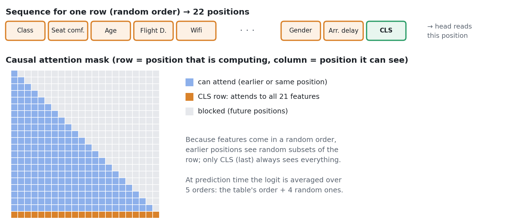

只有末尾 CLS 保证能看到全部 21 列。前面的位置只能看到随机顺序中的前缀，因此列序不再是无关紧要的排列。

---

## 解法一：训练时重排，推理时做顺序集成

训练时，每一行、每一步都重新随机排列 21 个特征，再把 CLS 放到最后。

这同时做两件事：

- 防止模型把某个固定位置误认为某列；
- 让 CLS 在不同随机前缀组合下学习汇总整行。

推理时，对表原顺序与 4 个随机顺序的 logit 取均值。

fold-0 上，固定顺序 0.953546，逐步重排 0.960444，差 0.0069 AUC；这是该篇唯一明显大于五折波动的消融。

> 注意：重排让模型近似适应集合输入，却没有在结构上保证置换不变；5 序平均也额外付出 5 次前向。

---

## 解法二：LoRA，只学习低秩修正

$$h=Wx+\frac{\alpha}{r}B(Ax),\qquad r=16,\ \alpha=32,\ \frac{\alpha}{r}=2$$

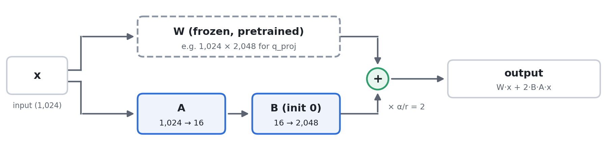

$B$ 初始化为零，所以训练第 0 步与原始 Qwen 等价。适配器挂在每层 attention 的 q/k/v/o 与 MLP 的 gate/up/down 共 7 个投影上。

---

## 参数账本：10.1M 可训练，不代表只跑 10.1M 模型

按 Qwen3-0.6B-Base 的配置重算：

- 每层 LoRA 参数 360,448；
- 28 层合计 **10,092,544**，约 10.1M；
- feature tokenizer、CLS 与预测头约 **3.9M**；
- 28 层冻结骨干约 **440.5M**，不含被共享的词嵌入表；
- 连同词嵌入表，整体约 0.6B。

冻结权重不需要更新，却仍要参与前向；反向传播也要穿过骨干，才能把梯度送回 LoRA 与 tokenizer。

> LoRA 减少的是优化器状态与可训练参数，不是同比例减少计算量。

---

## Q-FT 的训练配方：表格工程仍然很传统

- 每折 559,708 行，5 折 StratifiedKFold；
- batch 512，3 epochs，共 3279 steps；
- LoRA 学习率 $2\times10^{-4}$，tokenizer/CLS/头为 $10^{-3}$；
- AdamW，无 weight decay，3% warmup 后线性衰减；
- bf16 autocast，fp32 master weights，梯度裁剪 1.0；
- 单 A100，报告约 26 GB 峰值显存、每折约 52 分钟；
- 输出只是 CLS logit 上的 BCE，没有语言建模目标。

> 从训练目标看，它是彻底的判别式分类器；“Qwen”并没有把任务变成生成标签文本。

---

## 消融最容易被过度解读：8e-6 不能证明预训练无用

来源的 fold-0 对照：

- 预训练 Qwen + LoRA：0.960444；
- 随机初始化同架构 + 全量训练：0.960436；
- 冻结骨干，只训 tokenizer 与头：0.959788。

第一、二行只差 $8\times10^{-6}$，而同一模型五折跨度约 0.00164，且两行可训练参数集不同。因此“语言预训练没有收益”没有被这个对照识别出来。

另一方面，冻结骨干只比 LoRA 低约 0.0007，至少说明：在这个任务上，很大的可训练容量并不是必要条件。

> 正确读法：架构与输入接口已经很强；语言预训练到底贡献多少，仍未被干净地分离。

---

## Q-FT 的阶段性答案与留下的问题

它证明了三个工程动作可以拼起来：逐列双通道编码、连续向量直入 LLM、低秩适配。

但它也留下三个不舒服的地方：

1. 因果顺序与“行是集合”冲突，只能靠重排与 5 序平均缓解；
2. 只使用原始列，是否还能加入表格特有的统计信息？
3. 语言预训练收益不清楚，能否改为更贴近表格的自监督任务？

Q-FT v2 正好对应这三个问题：order-free、side features、RTD。

---

# 第三幕：Q-FT v2

把顺序约束、表格特征与自监督重新组合

---

## v2 全貌：ModernBERT、24 个位置、一次前向

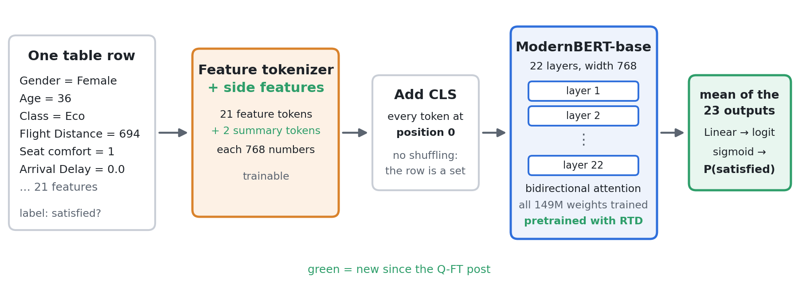

输入变为 CLS + 21 个特征 token + 2 个 summary token。21 个特征与 2 个 summary 的输出做均值，再接线性分类头；全部 149M 权重训练。

---

<!-- _class: small -->

## order-free：把“没有顺序”写进位置编号

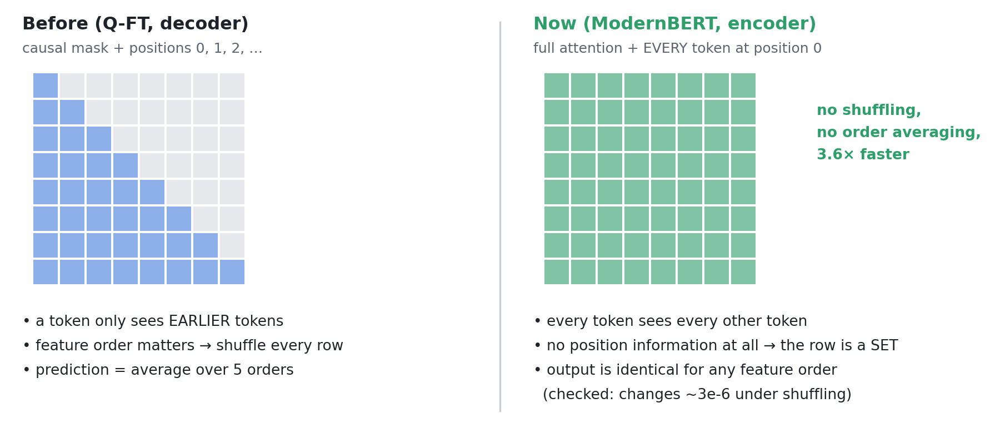

ModernBERT 使用 RoPE，而 RoPE 由传入的 `position_ids` 驱动。所有 token 都传 0，双向注意力下不再有任何列获得特殊位置。

来源报告：打乱顺序后输出变化约 $3\times10^{-6}$，接近浮点误差；训练不再重排，推理不再平均多个顺序。

---

## 三种“表是集合”的实现，代价不一样

- **FT-Transformer**：不注入位置 + 双向注意力，结构上置换等变；
- **Q-FT**：因果注意力 + 位置编号 + 训练重排，靠学习近似适应；
- **Q-FT v2**：双向注意力 + 所有 `position_ids=0`，恢复结构约束。

池化也随之改变：

- FT-T 与 Q-FT 读一个 CLS；
- v2 对 23 个非 CLS 输出做均值，再接 `Linear(768 → 1)`。

来源称 CLS head、attention pooling、mean+max 的差异在噪声内，因此选择最简单的 mean。

> 从 v1 到 v2 的核心进步，不一定是“更大的预训练”，而是去掉了错误的顺序归纳偏置。

---

## 一个外推边界：ModernBERT 并非每层都全局注意力

配置显示：局部窗口 128，并且每 3 层插入一次全局注意力。

本任务一行只有 24 个 token，小于 128，所以局部层也能覆盖整行，“双向”在这里实际上接近全连接。

如果一行扩展到数百 token：

- 局部层不再覆盖所有列；
- `position_ids=0` 仍然去掉位置，但不自动恢复全局交互；
- “24 token 时有效”的结论不能直接外推到宽表。

> order-free 解决的是位置问题，不自动解决长序列注意力的覆盖与成本问题。

---

## side features：每个值再补 9 个数，每行再补 2 个 token

每个特征 token 新增四类信息：

1. 取值在 train+test 与原始数据中的计数及比值；
2. 同一路由上其他列的均值、离散度等画像；
3. 用其余 20 列预测该列，得到期望值与残差，表示“这个值在行里是否典型”；
4. 原始数据标签在该确切取值上的平滑 log-odds。

另有两个 summary token：

- 28 个行统计量，例如评分和、均值、离散度、延迟差；
- 17 个原始数据块，例如外部模型预测与匹配行统计。

> v2 已不是 raw features only：第四类 side features 与第二个 summary token 都使用外部监督信息。

---

## RTD：不问“被遮住的原值是什么”，只问“这里被换过吗”

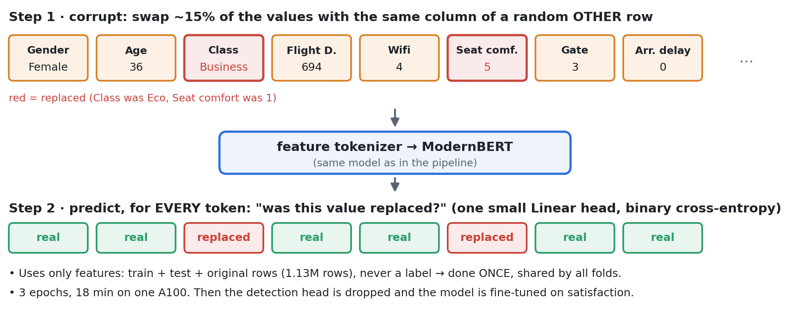

约 15% 的值被同列、随机另一行的值替换。模型对每个特征位置做真/替换二分类，预训练后丢掉检测头，再做满意度微调。

---

## RTD 的收益与评估边界必须一起记住

来源配方：

- train + test + 原始数据，共 1.13M 行；
- 不使用标签，3 epochs，单 A100 约 18 分钟；
- 只预训练一次，5 折共享同一初始化；
- fold-0 约增加 $3\times10^{-4}$ AUC；
- 后续微调从 3 epochs 降为 2，第 3 个 epoch 开始过拟合；
- 10 epochs 反而更差。

它不使用标签，但使用了测试特征与外部数据。因此收益包含“表格自监督”和“传导式信息”两部分，不能只归因于任务形式。

> RTD 学的是列内边际分布与列间一致性：替换值本身合法，放在这一行里却可能不协调。

---

## v2 的消融不是一路单调上涨

fold-0 的五步链：

- Q-FT 起点 0.960444；
- Qwen 改双向 + mean head：0.960602，上升；
- 换 ModernBERT order-free：0.960368，反而下降；
- 加 side features：0.960655；
- 加 RTD：0.960977。

OOF 从 v1 的 0.959795 到 v2 的 0.960798，但 v2 同时更换了骨干、训练方式、输入信息、外部数据与预训练，不能当作单变量架构证明。

成本口径也有多种：吞吐 3.18×、图注 3.6×、每折墙上 8.0×、5 折 GPU-分钟约 5.2×。

> 最稳的结论是“组合配方更快且分数更高”，不是“order-free 单独贡献了多少”。

---

# 第四幕：整行文本化

删掉 feature tokenizer，改变标签的位置

---

## 第四条路线：不再把每列压缩成一个向量

把整行直接写成：

`Gender is Female, Age is 36, Class is Eco, ..., satisfaction is True`

交给普通的 GPT-2 small，约 124M 参数。

这意味着：

- 列身份由文本列名表达；
- 数值与类别都变成词片序列；
- 不再手工构建逐列 code 词表；
- 序列化格式、文本分词器与列顺序成为新的核心设计；
- 标签的位置决定模型究竟在学什么。

> Q-FT 是“设计表格嵌入，借用 LLM 骨干”；文本化路线是“设计一段语言，让 LLM 自己决定如何分解”。

---

## 同一个 GPT，两种相反的阅读方向

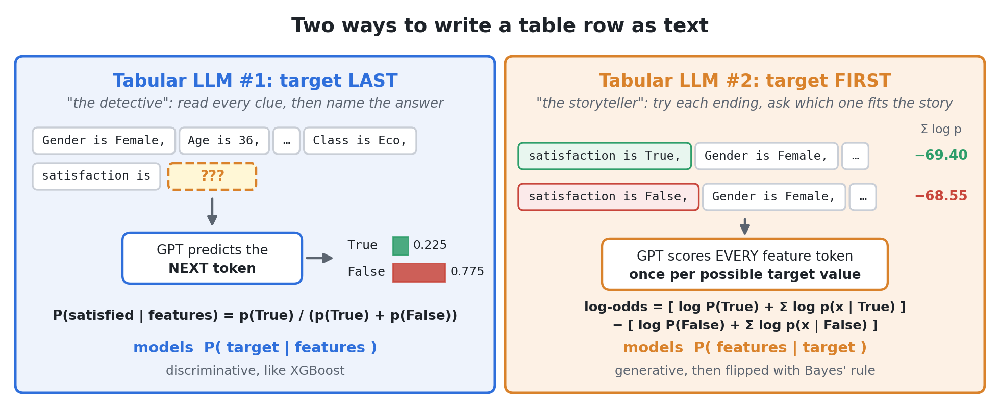

左侧 target-last 直接读下一个标签 token；右侧 target-first 分别给两种标签开头的完整故事打分。

---

## Detective：target-last，判别式分类器

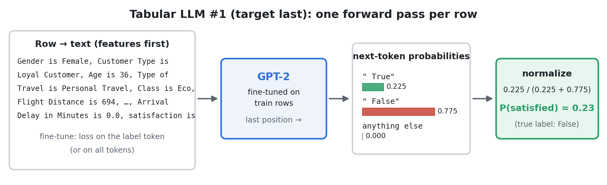

训练时特征在前、标签在后；loss 可只放在标签 token，也可放在全部 token。推理时截到 `satisfaction is`，读取带前导空格的 `" True"` 与 `" False"` 概率并归一化。

每行只需一次前向，建模对象是 $P(y\mid x)$。

---

## Storyteller：target-first，用 Bayes 公式反推标签

二分类时：

$$\operatorname{logit}P(y=1\mid x)=
\log\frac{P(y=1)}{P(y=0)}
+\log p(x\mid y=1)-\log p(x\mid y=0)$$

做法是：

1. 分别写出 `satisfaction is True, ...` 与 `satisfaction is False, ...`；
2. 两段都做一次完整前向；
3. 只对特征 token 的 log-prob 求和，跳过标签前缀；
4. 两个总分相减，再加类别先验 logit；
5. 对结果做 sigmoid，得到分类分数。

> 它不是直接问“标签是什么”，而是问“如果标签已经是这个值，整行有多像模型见过的世界”。

---

## 用一组具体数字走完 Bayes 打分

同一行在两个标签前缀下：

$$\sum\log p(x\mid True)=-69.40,\qquad
\sum\log p(x\mid False)=-68.55$$

特征似然差：

$$-69.40-(-68.55)=-0.85$$

再加入先验 logit 约 $-0.20$：

$$\operatorname{log-odds}=-1.05$$

$$P(satisfied\mid x)=\sigma(-1.05)\approx0.259$$

真实标签是 False。判别式版本对同一行给出约 0.23，方向一致，但分数来自不同的建模对象。

> 分类信号不是 −69 本身，而是两个大负数之间 0.85 nats 的差。

---

## 完整配方：先复刻生成器，再训练分类器，最后多顺序打分

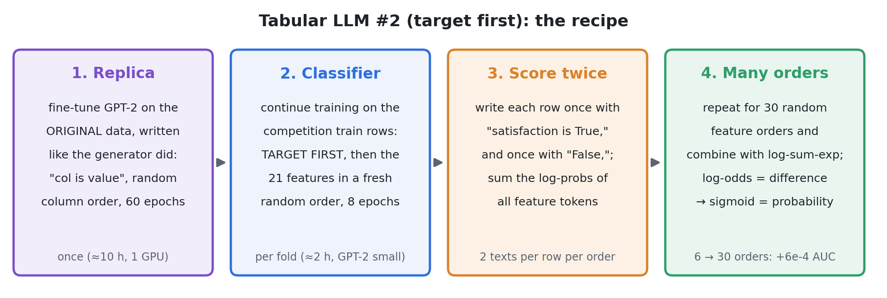

Replica 在原始数据上训练 60 epochs；分类器每折续训 8 epochs。来源称 60-epoch replica 比 8-epoch 版本带来约 +1.2e-3 AUC，起点质量是主要变量之一。

---

## 为什么还要 30 种列顺序

因果 LM 对序列顺序敏感，而表格列没有天然顺序。训练时每步随机列序，推理时重复构造多个顺序。

二分类、30 个顺序意味着：

$$K\times O=2\times30=60\text{ 次前向/行}$$

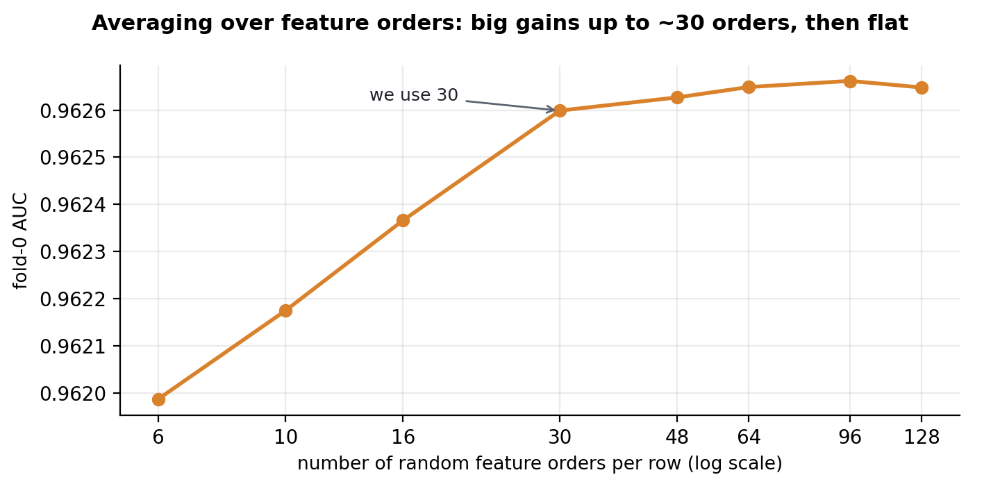

6 到 30 阶在 fold-0 上约提升 0.00062 AUC，之后基本平坦。该曲线是单折结果，不是全折 OOF。

---

## 顺序平均还有一个数学边界

对 $O$ 个顺序做 log-sum-exp，形式上接近：

$$\log\frac1O\sum_{o=1}^{O}p(x^{(o)}\mid y)$$

但不同序列化 $x^{(o)}$ 是同一表格的不同文本表示。若把它们当作多个观测，归一化常数与真实边际分布并不自动成立。

因此：

- 对 AUC 这类排序指标，单调分数通常已经够用；
- 对校准概率、阈值决策或交叉熵，缺少的归一化问题不能忽略；
- “30 阶 log-sum-exp 就是 Bayes 最优分类器”说得过强。

> 更准确的说法：它是对多种列序的条件密度分数做集成，再用于 Bayes 排序。

---

## 生成式分类的独特回报：证据可以精确相加

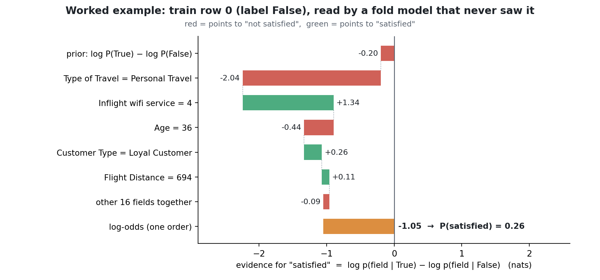

每个字段的证据定义为 $\log p(x_j\mid True)-\log p(x_j\mid False)$，按 token 边界分组求和后，与最终 log-odds 恒等对应。

---

## 证据可加，不等于字段独立

Personal Travel 贡献 −2.04，wifi=4 贡献 +1.34，其余字段也各有正负贡献。

这些数字来自同一个自回归分解：

$$\log p(x\mid y)=\sum_t\log p(x_t\mid x_{<t},y)$$

把 token 按字段分组，只是重写求和顺序；模型仍然可以在每个字段内部依赖前文。

所以它与朴素贝叶斯不同：

- 朴素贝叶斯的可加性来自条件独立假设；
- Storyteller 的可加性来自自回归对数似然的代数分解；
- 它是最终分数的恒等分解，不是注意力权重或梯度归因的代理。

> 但顺序平均后如何给“一个字段”分配跨顺序贡献，需要保留同一套分组规则，不能随意拼接不同顺序的数字。

---

## 文本化之后，格式本身就是模型的一部分

来源特别强调：

- 整数写 `36`，浮点写 `0.0`，缺失写 `None`；
- 标签写 `True` / `False`，并注意分词时的前导空格；
- 使用 GPT-2 自己的分词器；
- 分隔符、列名与小数格式应与预训练或 replica 阶段一致。

还有两个数值风险：

- 两个约 −69 的总 log-prob 相减只剩 0.85，累加与相减宜用 fp32；
- `n_prefix - 1` 之类切片若偏移一个 token，会形成系统性偏差。

> 生成式模型会把“`0` 与 `0.0` 的差别”也当成数据。格式不是展示层，而是似然定义的一部分。

---

## 为什么它在这个赛题上赢：一个有证据但未证实的生成过程假设

来源假设 Playground 数据由 GReaT 风格的 GPT-2 生成器写出，过程是“标签最先，再逐字段生成整行”。

支持线索：

- 数字的 token 边界呈现 GPT-2 分词器指纹；
- temperature 0.7、top-k 50 能复现部分分布扭曲；
- label-first 提示能复现训练集标签率。

若数据真的按 $y\rightarrow x$ 生成，学习 $p(x\mid y)$ 就与生成过程同向，target-first 自然有优势。

但这仍是**来源假设**：分词器指纹不能唯一识别 GReaT，且没有非合成数据对照。

> 不能把“这个合成赛题上生成式更好”外推成“真实表格都应该 target-first”。

---

# 第五幕：TFM 与整体比较

把训练移到上下文，把差异用于集成

---

## TFM：不是把一行写成文本，而是把训练集放进上下文

前面三条监督路线都要在当前任务上拟合参数。TFM 的核心说法是 in-context learning：

- 把若干带标签训练行作为上下文；
- 再放入待预测行；
- 模型根据上下文中的示例直接类推。

这改变了“训练”发生的位置：结构主要来自预训练，当前数据集以示例而非梯度更新进入模型。

潜在收益：无需为每张表完整重训，与树模型的误差结构不同。

现实边界：训练行必须装进上下文，预训练归纳偏置要与目标表匹配；本组赛题来源连“是否又做了微调”都没有完全对齐。

> 本 deck 只把 TFM 当作路线对照，不据此声称某个版本具有普遍的零样本能力。

---

<!-- _class: small -->

## 同一赛题的读数：方向差异比规模差异更醒目

来源报告的单模型 OOF AUC：

- Q-FT：0.959795；
- Q-FT v2：0.960798；
- 最好的 TFM：0.96115；
- 调参 XGBoost：0.96149；
- target-last GPT：约 0.961；
- target-first GPT-2 small：0.96242；
- target-anywhere：0.96245，略高于 target-first。

这里最醒目的不是 0.6B 输给 124M，而是**同一个文本化骨干只改变标签位置，就改变了建模方向与误差结构**。

同时必须保留两个冲突：target-anywhere 略高；TFM 与 9 个 TFM 的 stack 都没有超过调参 XGBoost。

> 这些数字来自单一合成赛题、单次五折与不完全一致的输入/外部数据，不是跨数据集的模型排行榜。

---

## 生成式模型的另一项价值：给集成带来不同的错误

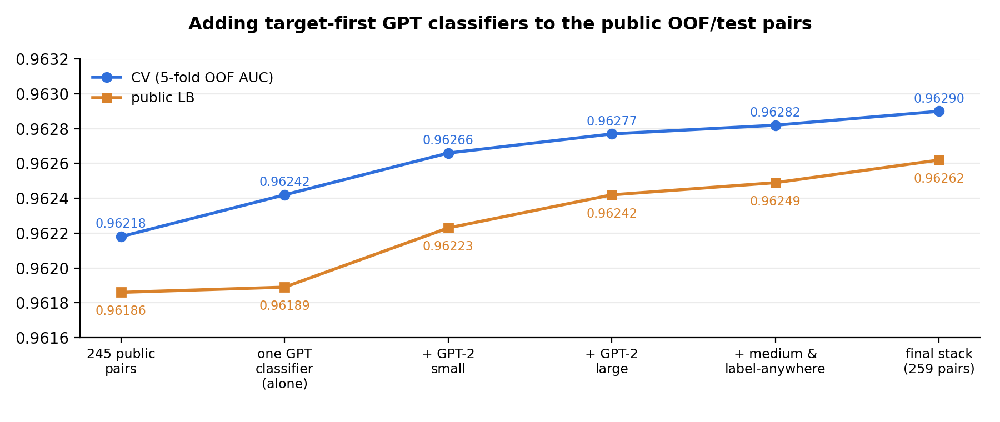

245 对公共模型的 stack 为 CV 0.96218；单个 target-first GPT 已达到 0.96242。把它加入池后继续上升，说明价值来自互补，不只是成员数量。

---

## “多堆模型”与“加入不同建模方向”不是一回事

来源中的两个对照：

- 9 个 TFM 一起 stack，只比最好单个 TFM 高约 $5\times10^{-5}$；
- 一个 GPT 分类器加入 245 对公共 pair，带来约 $4.9\times10^{-4}$ CV 增益。

一个合理且与机制一致的解释是：

- 同族 TFM 共享上下文式归纳偏置，误差高度相关；
- target-first 学 $p(x\mid y)$，与多数 $p(y\mid x)$ 成员从相反方向读同一行；
- 因此即使单模型只强一点，也能提供更大的组合价值。

最终 stack 中，10 个 GPT 系 pair 被来源称为承担约 80% 输出，但“输出”的权重口径没有完整说明。

> 集成要看误差是否互补，不要把 pair 数当作模型多样性的代理。

---

## 四条路线怎么选：先问约束，不先问 backbone

**列很多、延迟敏感**：先算 $O(k^2d)$ 与前向次数；FT-T 未必适合宽表，target-first 的 $K\times O$ 更贵。

**想快速建立监督基线**：GBDT、ResNet、FT-T 仍应优先；Q-FT 不是默认替代品。

**有大量无标签表格、可接受传导式预训练**：RTD 值得试，但必须报告 test 特征与外部数据的使用。

**数据可能由语言模型按 label-first 生成**：target-first 是有机制依据的候选；真实数据上需要重新验证。

**要做合成数据生成**：那是另一项任务，需要评估行级保真度、下游效用、隐私与约束满足，不能拿分类 AUC 代替。

---

## 如果复现，先冻结这八项设计契约

1. 列顺序：无位置、位置恒零，还是训练重排 + 推理平均？
2. 输入表示：逐列向量，还是完整文本？
3. 数值表示：线性、周期特征、分桶、双编码，还是文本分词？
4. 池化与预测头：CLS、均值，还是逐类密度打分？
5. 预训练：语言、RTD、replica，分别用了哪些行与标签？
6. 评估：fold-0 还是全折 OOF，是否使用 test 特征，外部数据是否折内可见？
7. 推理成本：每行几次前向，顺序数与类别数是多少？
8. 数值与格式：log-prob 累加精度、标签前缀边界、缺失与小数写法是否固定？

> 不先写清这八项，“同一个模型”的两次运行往往并不是同一个方法。

---

## 证据强度：哪些是机制，哪些只是单赛题观察

**相对扎实的机制事实**：FT-T 的逐列 tokenizer；Q-FT 的三段式嵌入与 LoRA 参数账本；v2 的位置恒零与 RTD 定义；target-first 的 Bayes 代数；$K\times O$ 推理成本。

**单赛题观察**：重排收益、RTD 增益、30 阶平台、target-first 相对 target-last 的优势、GPT 对 stack 的互补性。

**尚未证实的解释**：语言预训练无用；生成器就是 GReaT；target-first 在真实数据上普遍更好；TFM 只靠纯 in-context 就取得赛题分数。

**评估警告**：fold-0 与 OOF 不可混用；外部监督与 test 特征改变任务设定；许多差值小于折间波动。

---

## 最终带走四句话

**第一，表格 Transformer 的核心是表示与归纳偏置，不是“用了 Transformer”。**

**第二，Q-FT 到 v2 的关键转折，是把错误的列顺序假设从训练技巧中拿掉。**

**第三，target-first 的生成式分类不是文本生成技巧，而是 $p(x\mid y)$ 加 Bayes 反转；它用 $K\times O$ 次前向换来不同的归纳偏置与证据分解。**

**第四，这条路线目前最有说服力的成果是“机制可以被精确设计”，不是“生成式已经普遍打败 GBDT 或 TFM”。**

> 先识别数据的生成过程，再选择模型的阅读方向；先算推理成本，再谈分数。

---

<!-- _class: tiny -->

## 延伸阅读

机制与概念：

- `wiki/concepts/tabular-deep-learning.md`：FT-T、Q-FT、v2 与文本化路线的完整公式和对照；
- `wiki/concepts/generative-classification.md`：Bayes 代数、证据可加性、成本与数值边界；
- `wiki/comparisons/gbdt-vs-tabular-dl.md`：与 GBDT 的对照及跨来源冲突。

来源与精确定位：

- `wiki/sources/ft-transformer.md`：NeurIPS 2021 论文、官方实现与页码索引；
- `wiki/sources/kaggle-q-ft.md`：Q-FT 配方、参数账本与消融分歧；
- `wiki/sources/kaggle-q-ft-v2.md`：order-free、side features、RTD 与成本口径；
- `wiki/sources/kaggle-tfms-llms-tabular.md`：Detective、Storyteller、TFM、stacking 与生成过程假设。

本 deck 未重跑训练；数字与图片均转述自已核查的来源页。精确页码、行号、图注和证据冲突保留在上述页面中。
